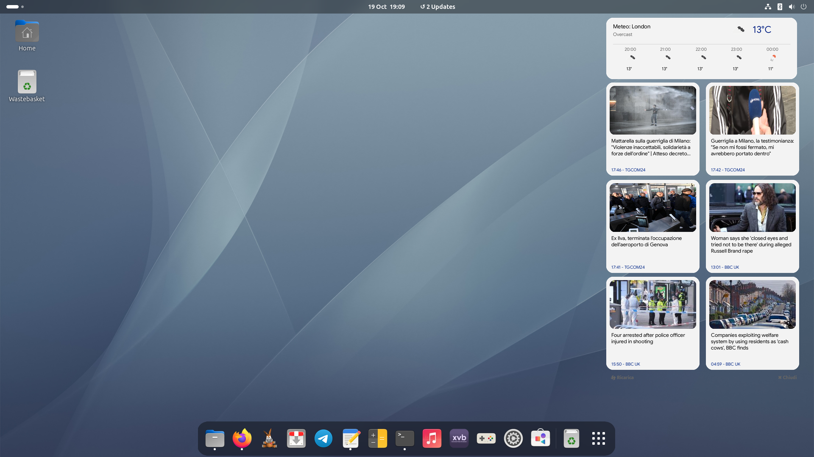

**🇮🇹 [Leggi in italiano? clicca qui](README.it.md)**

#  Ultimora

**Ultimora** is a modern, lightweight desktop widget written in Python using PyQt6. It shows the latest news from your favourite RSS feeds next to a weather card.



## Requirements
- Linux (GNOME/Mint/XFCE)
- Python 3.8+

There are two ways to use it: the `.deb` package (recommended, newer version) or the manual Python version.

---

## 1. Install with the .deb package (recommended)

Download the latest `.deb` from the Releases page of this repository, then install it. The dependencies are installed automatically:

```bash
sudo apt install ./ultimora_*.deb
```

Start it by clicking **News** in your application menu, or from a terminal:

```bash
ultimora
```

### Features
- News from any RSS/XML feed, all items loaded, scrolling with a hidden scrollbar
- Settings panel (⚙): paste a feed URL to add it, ✖ to remove it
- News automatically refreshed every 15 minutes
- Mixed mode: all feeds merged and sorted by time, or grouped by source
- Hide button: the widget collapses to a small icon, click it to show it again
- Images are cached, settings are saved between sessions

### Files
- Configuration: `~/.config/ultimora/config.json`
- Image cache: `~/.cache/ultimora/` (files older than 7 days are removed at startup)

### Uninstall
```bash
sudo apt remove ultimora
```

---

## 2. Manual installation (Python version)

The previous version of the widget, run directly from the source.

### Dependencies
```bash
sudo apt update
sudo apt install python3-pyqt6 python3-feedparser python3-pil
```

### Run
```bash
python3 ultimora.py
```

### Autostart (Systemd)
1. mkdir -p ~/.config/systemd/user
2. nano ~/.config/systemd/user/ultimora.service

```ini
[Unit]
Description=Ultimora Widget
After=graphical-session.target

[Service]
ExecStart=/usr/bin/python3 %h/scripts/ultimora/ultimora.py
Restart=on-failure

[Install]
WantedBy=graphical-session.target
```

3. systemctl --user daemon-reload && systemctl --user enable --now ultimora.service

Adjust the path in `ExecStart` if the script is not in `~/scripts/ultimora/`.

### Switch to the .deb version
If you run the manual version as a systemd service, remove the service first, otherwise two copies of the widget will start:

```bash
systemctl --user disable --now ultimora.service
rm ~/.config/systemd/user/ultimora.service
systemctl --user daemon-reload
```

Then install the `.deb` as described in section 1. You can delete the old script folder afterwards.
